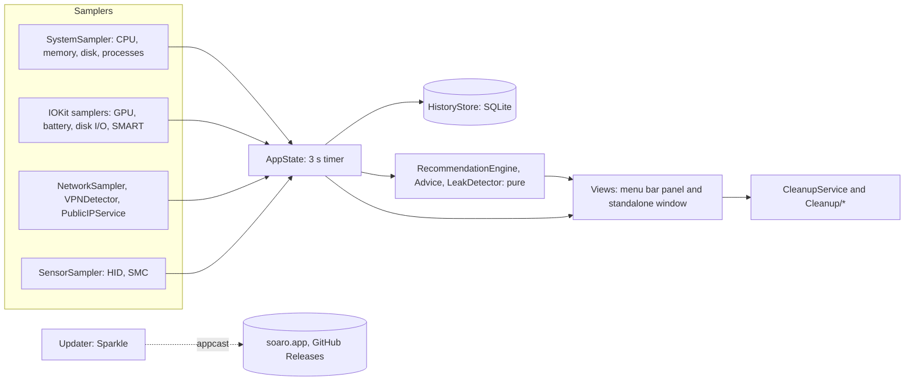

# Soaro: architecture

> Reconstructed on 2026-11-15 from the code and history. To be confirmed.
> Confidence marks: **[H]** directly visible in code or config, **[M]** inferred from several signals, **[L]** a guess.

| | |
| --- | --- |
| Status | draft (reconstructed) |
| Version | 0.1 |
| Date | 2026-11-15 |
| Based on | the code at `e4520dd` (v1.0.1). No `SPEC.md` yet |

The file-by-file reference, the command-line modes, the macOS permissions and the previous names are in [`docs/architecture.md`](docs/architecture.md). This document is the design view and does not repeat them.

## Context and scope

Soaro runs on one Mac, for one user, in the menu bar. It reads the machine (kernel counters, IOKit, a few system tools), shows it live and as history, and cleans caches and rebuildable folders after the user confirms. **[H]** `SoaroApp.swift`, README.

Outside the app: the website `soaro.app` (it serves the update feed through a redirect), GitHub Releases (the update archives), and two optional third-party lookups (public IP, ping to 1.1.1.1), both off by default. **[H]** README "Privacy".

## Decision drivers

1. **Safety of deletion**: never delete outside the home folder, always confirm. **[H]** README "Safety", `CleanupSafetyTests`.
2. **Cheap when idle**: 20-35 MB RAM and 1-2% of one core. **[H]** README; views removed when the panel is hidden.
3. **Privacy**: nothing leaves the Mac by default. **[H]** README "Privacy".
4. **Honesty about fragile data**: a failed sensor read hides the section. **[H]** `docs/architecture.md`.
5. **Testable without a real Mac**: pure functions for analysis and explicit locale in formatting. **[H]** `docs/architecture.md`.

## Overview

One `AppState` object (main actor) owns a 3-second timer. Each tick asks the samplers for a snapshot, appends to in-memory curves, feeds the aggregator that writes to SQLite, and recomputes recommendations. The views only read `AppState`. **[H]** `AppState.swift:185-250`.

## Components

| Component | Responsibility | Depends on |
| --- | --- | --- |
| `SoaroApp` / `AppDelegate` | `MenuBarExtra` scene, accessory activation policy (no Dock icon), CLI modes and demo/snapshot hooks, reopening opens the window | AppState, Updater |
| `AppState` | Timer, sampling cadence, history writes, actions, notifications, cleanup scans | Samplers, HistoryStore, engines, CleanupService |
| Samplers (`SystemSampler`, `Samplers/*`) | Read the machine; parse `ps`, `top`, `nettop`, `osascript` output | Mach, `sysctl`, IOKit, HID, SMC, system tools |
| `HistoryStore` | SQLite, aggregation by time slices, 30-day retention | `sqlite3` |
| `RecommendationEngine`, `Advice`, `LeakDetector` | Pure analysis: measurements in, recommendations and tips out | Models only |
| `CleanupService`, `Cleanup/*` | Scanners (caches, large files, dev artifacts, uninstaller leftovers, login items) and the deletion rules | FileManager, Finder (Apple Events) |
| `Views/*`, `MainWindow` | Tabbed panel and standalone window (AppKit window, created on demand) | AppState |
| `Updater` | Sparkle, inactive without `SUFeedURL` and `SUPublicEDKey` | Sparkle |
| `LegacyMigration` | Imports history and preferences from former app names | UserDefaults, files |
| `DemoData`, `Snapshot`, `Diagnostics` | Demo mode, PNG snapshots, read-only CLI output | AppState |
| `scripts/`, `.github/workflows/` | App assembly, signing, DMG, notarization, appcast, CI | Xcode 26, Sparkle tools |

All **[H]**, from `docs/architecture.md` and the sources.

## Data and storage

- **History**: `~/Library/Application Support/Soaro`, SQLite (WAL), one aggregated row per ~30 s, kept 30 days. **[H]** `HistoryStore.swift`.
- **Preferences**: `UserDefaults` (`SettingsKey`). **[H]**
- **Nothing else is stored.** Public IP lookups are not stored. **[H]** README.

## Key flows

1. **Measure and show** (every 3 s): timer, then `tick()`: snapshot, curves, aggregation, recommendations, views update. Battery every 9 s and sensors every 9 s when the panel is closed (every 3 s when visible). **[H]** `AppState.tick`.
2. **Clean up**: scan (every 30 min and on demand), then the user chooses, then a confirmation, then `isSafeToDelete` per path, then delete (caches, rebuildable folders) or move to the Trash (large files, uninstalled apps), then a rescan. The Trash is emptied through Finder with `osascript`. **[H]** `CleanupService.swift`, `AppUninstaller.swift`, `DevArtifactScanner.swift`.
3. **Update**: Sparkle reads `soaro.app/appcast.xml`, which redirects to the latest GitHub release; it downloads the DMG and checks its EdDSA signature against the public key in `Info.plist`. **[H]** `docs/updates.md`, `site/_redirects`.
4. **Release**: tag `vX.Y.Z`, then `release.yml` on `macos-26`: tests, import certificate, `scripts/release.sh --notarize`, then the GitHub release with the DMG and the appcast. **[H]** `.github/workflows/release.yml`.

## Cross-cutting concerns

- **Security and privacy**: not sandboxed; deletion confined to the home folder; two optional network features off by default; Sparkle verifies update signatures; secrets only in GitHub Actions secrets. **[H]**
- **Errors and recovery**: sensor failures hide the section; a failed delete counts as a failure and continues; a missing history database leaves history disabled (`history?`). **[M]**
- **Observability**: `SOARO_DEBUG` traces, `--diagnostics`. No telemetry. **[H]**
- **Testing**: Swift Testing, 135 tests, mostly pure functions and parsers (see `TESTING.md`). **[H]**
- **Build and release**: SwiftPM binary assembled by `scripts/build-app.sh` (Info.plist written by the script, Sparkle embedded, translations compiled with `xcstringstool`). **[H]**
- **Cost to run**: GitHub Actions minutes on a public repository (free), Cloudflare Pages (free tier), one Apple Developer account. **[M]**

## Decisions

| ADR | Decision | Status |
| --- | --- | --- |
| [0001](docs/adr/0001-native-swift-menu-bar-app.md) | Native Swift menu bar app, macOS 14+, Apple silicon only | accepted (reconstructed) |
| [0002](docs/adr/0002-distribution-outside-the-app-store.md) | Distribute outside the Mac App Store, not sandboxed | accepted (reconstructed) |
| [0003](docs/adr/0003-sparkle-updates-and-appcast-as-release-asset.md) | Sparkle updates; the appcast is a release asset reached through a redirect | accepted (reconstructed) |
| [0004](docs/adr/0004-history-in-sqlite.md) | History in SQLite through the C API | accepted (reconstructed) |
| [0005](docs/adr/0005-defensive-sensor-readings.md) | Read hardware sensors through private interfaces, hide what fails | accepted (reconstructed) |
| [0006](docs/adr/0006-cleanup-safety-model.md) | Confirmed, home-folder-only deletion; Trash when recoverable | accepted (reconstructed) |
| [0007](docs/adr/0007-privacy-by-default.md) | Nothing leaves the Mac by default | accepted (reconstructed) |
| [0008](docs/adr/0008-release-built-on-github-actions-xcode-26.md) | Release built by GitHub Actions on Xcode 26 | accepted (reconstructed) |

Smaller choices (notes, no ADR):

- Swift 5 language mode inside a Swift 6 tools package, so strict concurrency is off. Reason unknown, to confirm. **[H]** `Package.swift`.
- The app Info.plist is written by `build-app.sh`, not by Xcode. **[H]**
- The main window is AppKit (created on demand, destroyed on close) rather than a SwiftUI `Window` scene; reason inferred: cost when idle. **[L]**
- GPL-3.0 licence. **[H]** `LICENSE`.

## Traceability

No `SPEC.md` exists yet, so requirement IDs are not assigned. The features map to components as in the tables of the README; `PLAN.md` and `SPEC.md` are for the next feature.

Components with no requirement: all, pending the spec.

## Risks and spikes

| # | Risk or unknown | Spike or mitigation | Status |
| --- | --- | --- | --- |
| 1 | HID and SMC readings break on a new macOS | Failed read hides the section (ADR 0005); test the app on each macOS beta | open |
| 2 | Docker, OrbStack and simulator cleanup is more dangerous than file caches (shared volumes, running containers) | Spike before the next feature: which paths are safe to touch, and how to detect a running engine | open (feature not specified) |
| 3 | Sparkle's window may stay behind other windows for an app without Dock icon | Test during the 1.0.0 to 1.0.1 update | open (`docs/updates.md`) |
| 4 | Strict concurrency never enabled | Try Swift 6 mode in a branch and count the errors | open |

## Deferred and open

- Not decided yet: how developer caches beyond file folders are cleaned (see risk 2); who reviews the translations.
- Deliberately out of scope: Intel Macs, the Mac App Store (README "Limits").
- Rationale unknown, to confirm: Swift 5 language mode; the choice of an AppKit window.

## Change log

| Date | Change | ADR |
| --- | --- | --- |
| 2026-11-15 | Reconstructed from the code at `e4520dd` | 0001-0008 |
