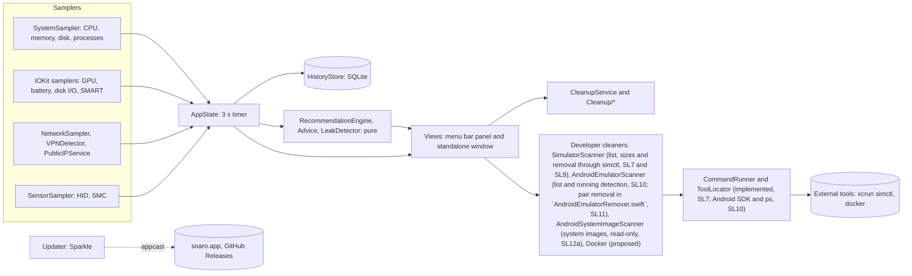

# Soaro: architecture

> Reconstructed on 2026-11-15 from the code and history. To be confirmed.
> Confidence marks: **[H]** directly visible in code or config, **[M]** inferred from several signals, **[L]** a guess.

| | |
| --- | --- |
| Status | draft (reconstructed, extended on 2026-11-15 for the developer cleanup of `SPEC.md` v0.3) |
| Version | 0.2 |
| Date | 2026-11-15 |
| Based on | the code at `e4520dd` (v1.0.1) and `SPEC.md` v0.3 (developer cleanup only). Parts marked "planned" are decisions, not code |

The file-by-file reference, the command-line modes, the macOS permissions and the previous names are in [`docs/architecture.md`](docs/architecture.md). This document is the design view and does not repeat them.

## Context and scope

Soaro runs on one Mac, for one user, in the menu bar. It reads the machine (kernel counters, IOKit, a few system tools), shows it live and as history, and cleans caches and rebuildable folders after the user confirms. **[H]** `SoaroApp.swift`, README.

Outside the app: the website `soaro.app` (it serves the update feed through a redirect), GitHub Releases (the update archives), and two optional third-party lookups (public IP, ping to 1.1.1.1), both off by default. **[H]** README "Privacy".

## Decision drivers

1. **Safety of deletion**: never delete outside the home folder, always confirm. **[H]** README "Safety", `CleanupSafetyTests`.
2. **Cheap when idle**: 20-35 MB RAM and 1-2% of one core. **[H]** README; views removed when the panel is hidden.
3. **Privacy**: nothing leaves the Mac by default. **[H]** README "Privacy".
4. **Honesty about fragile data**: a failed sensor read hides the section. **[H]** `docs/architecture.md`.
5. **Testable without a real Mac**: pure functions for analysis and explicit locale in formatting. **[H]** `docs/architecture.md`.

For the developer cleanup (`SPEC.md`), the ranking agreed on 2026-11-15 is: 1 safety of deletion, 2 honesty about fragile data (external tools can be missing, fail or change their output), 3 testable without the real tool, 4 privacy, 5 cheap when idle. The time box (14 working days for the Must scope) acts as a sixth driver: copy the existing patterns before inventing a framework.

## Overview

One `AppState` object (main actor) owns a 3-second timer. Each tick asks the samplers for a snapshot, appends to in-memory curves, feeds the aggregator that writes to SQLite, and recomputes recommendations. The views only read `AppState`. **[H]** `AppState.swift:185-250`.

## Components

| Component | Responsibility | Depends on |
| --- | --- | --- |
| `SoaroApp` / `AppDelegate` | `MenuBarExtra` scene, accessory activation policy (no Dock icon), CLI modes and demo/snapshot hooks, reopening opens the window | AppState, Updater |
| `AppState` | Timer, sampling cadence, history writes, actions, notifications, cleanup scans | Samplers, HistoryStore, engines, CleanupService, announcer (injected) |
| Samplers (`SystemSampler`, `Samplers/*`) | Read the machine; parse `ps`, `top`, `nettop`, `osascript` output | Mach, `sysctl`, IOKit, HID, SMC, system tools |
| `HistoryStore` | SQLite, aggregation by time slices, 30-day retention | `sqlite3` |
| `RecommendationEngine`, `Advice`, `LeakDetector` | Pure analysis: measurements in, recommendations and tips out | Models only |
| `CleanupService`, `Cleanup/*` | Scanners (caches, large files, dev artifacts, uninstaller leftovers, login items) and the deletion rules | FileManager, Finder (Apple Events) |
| `CommandRunner` (implemented, SL7; ADR 0009) | Protocol `CommandRunner` (`Cleanup/CommandRunner.swift`) and `RealCommandRunner` (`Cleanup/RealCommandRunner.swift`, the only new code that uses `Process`): absolute path only, no shell (`sh`, `bash`, `zsh`, `dash`, `ksh`, `csh`, `tcsh`, `fish` and `env` are refused, also through `..` or a symlink), arguments as an array, stdin `/dev/null`, a time limit that kills the process with SIGKILL, output read while running and bounded per stream (past the cap: the process is killed, the output cut, `truncated` set). Outcomes: completed, timed out, failed to launch, refused. No default runner: scanners take it as a parameter without a default value, and the real one is built in exactly two places, `Diagnostics.scan` (through `Diagnostics.simulatorScan`) and `CleanupTab` (a source test allows nothing else). The fake is hand-written in the test target. **Known limit:** grandchild processes of a killed tool are not killed. The four existing copies of a `Process` helper stay | Foundation `Process` |
| `SimulatorToolDetector` (implemented, SL8; pure, injectable) | Looks at the disk and **launches nothing** (no `xcrun`, no `xcode-select`, no `DEVELOPER_DIR`, no PATH): the devices folder exists, or **the `simctl` that `/usr/bin/xcrun` will actually run** is an executable regular file. `xcrun` follows the active developer folder, so: if `/var/db/xcode_select_link` is a symbolic link, the only candidate is its destination plus `/usr/bin/simctl` (a relative destination is resolved against `/var/db`; no fallback, so Command Line Tools active with Xcode installed gives "absent"); only when the link is missing, `xcode-select`'s own fallback: `/Applications/Xcode.app/Contents/Developer/usr/bin/simctl`, then each `/Applications/Xcode*.app` by name. Tool present = devices folder or the active `simctl`. Xcode copies under `~/Applications` are not found (accepted) | FileManager (behind a small protocol) |
| `ToolLocator` (`xcrun`, SL7; Android SDK and `ps`, SL10; ADR 0009) | Returns the first candidate that is an absolute path to an executable regular file, else nothing; the simulator candidates are exactly `/usr/bin/xcrun`. Gate (SL8): `simulatorXcrunPath` gives `/usr/bin/xcrun` only when the detection found a `simctl`, so the runner is never called without the active `simctl`; `Diagnostics.simulatorScan` (used by `--scan`) applies the same gate. **Android (SL10, implemented):** `androidSDK(environment:home:isDirectory:)` is pure, launches nothing and never reads the PATH: of `ANDROID_SDK_ROOT` then `ANDROID_HOME`, the first variable that is set and non-empty decides (an absolute path to an existing directory is the SDK; anything else gives no SDK, with no fallback), and only when neither is set `<home>/Library/Android/sdk`; the result carries its source. `processListCandidates` is exactly `/bin/ps`. Docker (SL13) candidates come with their slice. Target design for Docker: `docker` from candidate paths, never the PATH | FileManager |
| `SimulatorScanner` (listing and sizes, SL7; removal, SL9) | Runs `/usr/bin/xcrun simctl list devices -j` (time limit **60 s**, output cap **8 MiB**), parses it (`SimulatorDevice`), then measures `CleanupService.allocatedSize` of `~/Library/Developer/CoreSimulator/Devices/<udid>` (the whole device folder; never `dataPath` or `dataPathSize` from the tool; the UDID must match the UUID pattern before it is joined to a path). States: ok, tool not found, command failed, timed out, output not readable (a truncated output is not parsed). No fallback to a folder listing when the tool fails. The listing is a separate synchronous step (`list`, one runner call, devices without sizes) and the folder of a device is built by `deviceFolder(udid:home:)` (valid UDID only); `scan` is rebuilt on both. **Removal (SL9):** `delete(runner:xcrunPath:udid:)` runs exactly `<xcrun> simctl delete <udid>` (absolute path from the SL8 gate, one UDID per call, nothing launched for an invalid UDID or a missing path; time limit **60 s**, output cap **1 MiB**; removed only on exit code 0, ordinary exit and untruncated output; the error output is never read). `remove(runner:xcrunPath:home:measure:udid:)` handles one device in this order: a fresh `list` right before (absent: already gone; state not `Shutdown`: refused with the device's name; list failed or timed out: no delete), the scope (`deviceFolder` passing `CleanupService.isSafeToDelete`, strictly inside the home folder, else refused with no command), the measure of the folder, the delete, and the measure again only if it succeeded (freed is before minus after, floored at 0). **No fallback:** nothing in the simulator files removes a folder by hand (a source test guards it). `SimulatorRemovalSummary` (pure) adds up a batch and writes the toast | CommandRunner, ToolLocator, CleanupService |
| `AndroidEmulatorScanner` (implemented, SL10: list and running detection, read-only; **removal, SL11**, in `Cleanup/AndroidEmulatorRemover.swift`) | Pure parsing (`isValidAVDName`, INI, system label from `image.sysdir.1`, display name); `listAVDs(home:)` reads `<home>/.android/avd` (see the facts block below); `runningAVDNames(runner:psPath:)` runs `/bin/ps -axww -o command=` (10 s, 4 MiB) and reads `-avd <name>` and `@<name>`; `list(runner:psPath:environment:home:)` chains SDK, AVDs, `ps` (no SDK: hidden; unreadable folder or unavailable `ps`: could not read; no AVD: `ps` not called). `AndroidEmulatorReport` is the `--scan` text, `AndroidEmulatorPresentation` the pure row text. A source test forbids `removeItem(`, `trashItem(`, `"/bin/rm"`, `createFile(` and `write(to:` in every `Android*.swift`, **except** that `AndroidEmulatorRemover.swift` (and only it) may contain `removeItem(`, and has its own test forbidding the other patterns, `avdmanager` and `Process(`. **Removal (SL11), per target, in this order:** (1) `prepareRemoval`: a **fresh** `listAVDs` (the scan-time path is never trusted; unreadable: could not check), the target found by exact name or alias (gone and no `.ini`: already gone; not found but the `.ini` exists: refused), the fresh folder equal to the scan-time folder (the scan-time folder is NOT resolved again; a mismatch is refused, never followed), the folder and **every** `.ini` of the plan through `CleanupService.isSafeToDelete` (else refused), every `.ini` an ordinary file or a link to one (a directory named `<name>.ini` is refused), the registered folder (the name and every alias) not a symbolic link, and a folder that holds another listed AVD or the registrations folder refused; (2) measure before (folder plus each `.ini`, read-only, the long step); (3) `runningCheck`, as close to the deletion as possible so an emulator started during the measure is seen: a fresh `runningAVDNames` (`/bin/ps`, 10 s, 4 MiB; unavailable: could not check, never "timed out"), any name of the plan running: refused with the fresh display name (the measure of step 2 may have run once before such a refusal; nothing is deleted; no measure and no `ps` call when step 1 stops); (4) the deletion through `AndroidEmulatorRemover.removeFile`, which **checks again right before each `removeItem`**: `isSafeToDelete`, a real directory (not a link put there since, its path equal to its own resolved path, named `*.avd`, with an ordinary `config.ini`) or an ordinary `*.ini` file, else it throws and deletes nothing; the **folder first**: if the folder fails or remains, no `.ini` is deleted; the device stays listed and retryable **while the folder is still a valid AVD folder** (it still holds its `config.ini`), whereas a folder deleted in part (its `config.ini` already gone) is no longer listed and its registration remains; then each `.ini` (primary, then aliases); if the folder is gone but a `.ini` fails, that `.ini` stays as an orphan registration that Soaro can no longer list and that Android Studio shows broken (the result is a failure, the toast does not count it as freed); (5) measure after, freed = before minus after floored at 0. A microsecond window remains between the last check of `removeFile` and `removeItem` (a same-user writer in the home folder): accepted, closing it would need deletion relative to an open folder handle. A registered folder path that is not in its standardized form (a `.` or `..` component, `//`) is refused at plan time (`lstat` on `Link.avd/.` would follow the link); a trailing slash alone is accepted. Direct deletion (`FileManager.removeItem`), no Trash, **no `avdmanager`**, no shell, no runner call but `ps`. System images are in the next row (SL12a); `AndroidEmulatorScanner` only carries the raw `image.sysdir.1` of each AVD (`AndroidDevice.imageSysdir`) and makes `isStrictlyInside` and `resolvedPath` internal for it | FileManager, CommandRunner, ToolLocator |
| `AndroidSystemImageScanner` (implemented, SL12a, **read-only**, in `Cleanup/AndroidSystemImageScanner.swift`; `AndroidSystemImagePresentation`, `AndroidSystemImageReport`) | `imageKey(imageSysdir:)` (pure: `android-<N>[.<M>]/<variant>/<abi>` from the same segment rule as `systemVersion`, compared without regard to case). `listImages(sdk:home:)` (synchronous, pure file reads, **no runner parameter**, writes nothing): the SDK, resolved, must be strictly inside the home (else `sdkOutsideHome`, nothing read); `system-images` missing is `ok` and empty, a file or an unlistable folder is `unreadable`; exactly three levels; every level and every ABI folder must resolve strictly inside the home; an ABI folder is an image only if it holds a regular `source.properties` or `package.xml`; skipped and **counted** (a number only): a name that is not `android-<N>[.<M>]` or fails `isValidAVDName`, an unlistable level, a folder outside the home, no marker file, a second name for a folder already taken (that name's key is kept on the folder, `AndroidSystemImageFolder.keys`, so a device that writes it still matches; the displayed key is the real folder name when it can be read); sorted by version (numeric) descending, variant, ABI. `usage(images:devices:incompleteness:)` (pure) rates each image: `usedBy` (every listed AVD with the same key, display order, each once), `cannotTell` (no user and the incompleteness is not empty) or `notUsed`. The incompleteness reasons are `customLocation` (`ANDROID_AVD_HOME`, `ANDROID_USER_HOME`, `ANDROID_EMULATOR_HOME`, `ANDROID_SDK_HOME`, `ANDROID_PREFS_ROOT` set and not empty in the injected environment, in that order; the last two were added from recollection of the Android tooling and are **unverified on the author's setup**, he can drop them), `avdFolderUnreadable`, `skippedRegistrations(n)` (registrations that gave no device; aliases excluded, through `AndroidAVDListing.unreadableRegistrationCount`, while `skippedCount` keeps its SL10 and SL11 meaning) and `unknownImage(n)`: never a path or a value. `list(environment:home:)` chains `ToolLocator.androidSDK` (no SDK: `sdkNotFound`, nothing else read), `listImages`, then `listAVDs` only when there is an image; it never calls `list` or `ps` and takes no runner. A word-list source test (a tripwire, not a proof; it does not cover code outside those files) fails if removal, writing, launching or network patterns appear in any `AndroidSystemImage*.swift` (no removal code was written; SL12b) | FileManager, ToolLocator, AndroidEmulatorScanner |
| `DeviceSuggestions` (implemented, SL7, pure; shared by Android, SL10) | Pre-selects devices idle for strictly more than the limit (whole days, the limit is a parameter, default 60 days, confirmed on 2026-11-17) and older copies of the same model and runtime; devices under 100,000,000 bytes are counted, not listed. Android (`suggestAndroid`, `SizedAndroidDevice`, SL10) uses the same limit, threshold and whole-days rule, without the older-copy rule | Models only |
| `SimulatorsModel`, `SimulatorsView`, `SimulatorPresentation`, `SimulatorsScreen` (implemented, SL8; deletion, SL9; Android group, SL10; Android deletion, SL11; images group, SL12a) | The tool of the Cleanup tab. **Images group (SL12a):** a third group (`imagesPhase`, `imageRows`, sizes keyed by image key, `imagesUsageIncomplete`), listed in the same detached task after the Android listing and applied at the same moment (no SDK, SDK outside the home or no image: hidden; `system-images` unreadable: failed, the other groups stay usable); its sizes are measured one folder at a time after the Android sizes, off the main actor, with the cancel token checked before and after each, and rows are sorted by size when the last arrives. It is **independent of Delete**: image measuring never feeds `isMeasuring`, `canDelete`, the header summary, `listedCount`, `measuredSizeTotal`, `hiddenSmallCount`, `showsNothingToSuggest`, `selectedCount` or `selectedSize`; there is no selection, no `Group` case for "Select all" and nothing in the deletion targets; Back and the rescan after a deletion clear and reload it; an images-only screen has no Delete bar (`SimulatorsScreen.layout(ios:android:images:)`). **Android group (SL10):** next to the iOS one, with its own phase (hidden, listing, failed, empty, listed), rows, sizes and selection keyed by AVD name; `environment` is an init parameter with no default and the `ps` path comes from the same locate closure (`locateTool`); one detached task lists `simctl list` then `ps`, then sizes are measured iOS rows first, then Android rows; the iOS group is hidden when neither the devices folder nor `simctl` exists; the limit, the totals, the footer, "Scan again" and `showsNothingToSuggest` add both groups; the Android group **is pre-selected** since SL10b (`DeviceSuggestions.androidPreselectionEnabled`, one switch, now `true`: the author settled the last-used signal on 2026-11-17, see the facts above; it was off in SL10 and SL11), a limit change recomputes it with `.replace` like iOS, and the "Nothing to suggest" banner considers Android again (a group whose switch is off would still be ignored); **Delete acts on both groups (SL11):** `canDelete` (pure static, `phase`, `androidPhase`, `isMeasuring`, iOS and Android checked counts, `isDeleting`) is true when nothing is measured, nothing is being deleted and a row is checked in a listed group; one confirmation (the existing title and message, counting and sizing both groups), then one batch behind the same `SimulatorDeletionGate` and `CancelToken`: iOS targets first (`SimulatorScanner.remove`), then Android targets (`AndroidEmulatorScanner.remove`, with `removeFile`, an init parameter defaulting to `AndroidEmulatorRemover.removeFile`); `DeviceRemovalSummary` (pure; the only toast text: an iOS-only batch is a mixed batch without Android) runs `SimulatorRemovalSummary.run` once per group with the same `isCancelled` and builds the toast; a failure, a "could not check" or a time-out in one group never stops the other, Back stops both; detection and the `xcrun` gate are evaluated only with an iOS target, the `ps` path is looked up only with an Android target; `SimulatorsScreen.layout` (pure) picks the body. The rest of this row describes the iOS group and the shared behaviour. The model (`@MainActor`, owned by `CleanupTab`) takes the runner **without a default**, the detection, `home`, `now`, `measure` and the demo flag; the listing runs in a detached task (utility priority) with a `CancelToken`, never in the 3-second tick, and the real runner is built in a **second place**, `CleanupTab` (the first is `Diagnostics.scan`; a source test allows nothing else). States: not scanned, hidden, listing, failed (neutral message; "did not answer" for a time-out), empty, listed. **Progressive sizes:** rows appear when the list arrives (listing order, size "…"), each size is measured one device at a time off the main actor and applied as it arrives, a device under 100,000,000 bytes leaves the list and the selection at once, and the rows are sorted by size when the last size arrives; a cancelled scan applies nothing more. The pre-selection comes from `DeviceSuggestions` (unknown sizes count as big enough until measured); a limit change (30, 60, 90, 180 days, not remembered) replaces the selection with no rescan. `SimulatorPresentation` is the pure text (system label with `xrOS` shown as `visionOS`, reason line, the kept device's name, VoiceOver description). Demo mode returns made-up devices at once (`DemoData.simulators`). **Delete (SL9):** the model takes `confirm: ConfirmHandler` with no default (`CleanupTab` passes `SystemConfirmation.ask`, that is `AppState.confirm`); `canDelete` needs the list shown, the sizes measured, a device checked and no deletion running; after the confirmation (title with the count, message with the size and the loss, "Delete" as the critical button) a batch runs in a detached task (user-initiated priority, `CancelToken`, never in the tick), re-evaluating the detection and the `xcrun` gate at action time, then the toast, then a rescan. **One batch at a time for the whole process:** `SimulatorDeletionGate` (`@MainActor`, shared by default, injectable in tests) is taken before the batch and freed at its end whatever the outcome; while it is busy no model of the process can start a batch or scan (the panel and the window each own a model, and a model is destroyed when the user leaves the Cleanup tab), `isDeleting` and the busy screen follow the gate, and a scan asked on a not-yet-scanned screen is remembered and started when the gate becomes free. The toast and the gate release do not depend on the model (a destroyed model does not stop the batch from reaching its toast); only the final rescan goes through the model, weakly. The list of another surface may be stale after a batch; a device already gone is then reported as "already gone", not as a failure. The screen is busy ("Deleting…") and `toggle`, `setLimit` and `scan` are ignored meanwhile; Back finishes the current device, starts no other, skips the rescan and returns the phase to "not scanned"; devices never tried are counted as not removed in the toast, and a Back before any attempt shows no toast. In demo mode the same confirmation is asked, then the rows leave in memory with a made-up freed amount (nothing launched, measured, read or written) | CommandRunner, ToolLocator, SimulatorToolDetector, DeviceSuggestions, CleanupService |
| `SimulatorReport` (implemented, SL7, pure) | The text of the `== iOS Simulators` section of `Soaro --scan`, in plain English (not localised), built from a scan result, the suggestions, a locale and the limit | Format |
| Docker cleaner (proposed, ADR 0010) | Lists usage and prunes the build cache and untagged images through the `docker` command; measures the host space returned | CommandRunner, ToolLocator |
| `Views/*`, `MainWindow` | Tabbed panel and standalone window (AppKit window, created on demand). The cleanup tool models are `StateObject`s of `CleanupTab`, not part of `AppState`; the route `CleanupRoute.simulators` (SL8, implemented) opens the tool "Simulators and emulators" (iOS and Android in one list, `DESIGN.md`; Android comes with SL10), and a second route for Docker only if Test B passes | AppState |
| `Updater` | Sparkle, inactive without `SUFeedURL` and `SUPublicEDKey` | Sparkle |
| `LegacyMigration` | Imports history and preferences from former app names | UserDefaults, files |
| `DemoData`, `Snapshot`, `Diagnostics` | Demo mode, PNG snapshots, read-only CLI output | AppState |
| `scripts/`, `.github/workflows/` | App assembly, signing, DMG, notarization, appcast, CI | Xcode 26, Sparkle tools |

All **[H]**, from `docs/architecture.md` and the sources.

### Simulator scan (SL7, 2026-11-16): facts recorded

- **A1, last-used key.** Read from the real output of `xcrun simctl list devices -j` on the author's Mac: the key is `lastUsedAt`, an ISO 8601 date without fractional seconds (the parser also accepts fractional seconds). It is present on some devices only (16 of 42): the others are "unknown" and are never pre-selected. `lastBootedAt` is read only if `lastUsedAt` is absent. No file date is used.
- **A8, runner values.** `simctl list`: time limit 60 s, output cap 8 MiB. `simctl delete`: time limit 60 s per device, output cap 1 MiB (SL9; they settle the open point of ADR 0009, which is not edited). These are the only values in the code (constants of `SimulatorScanner`: `listTimeLimit`, `outputLimit`, `deleteTimeLimit`, `deleteOutputLimit`); the runner has no default limit. After a time-out the runner kills `xcrun`, and CoreSimulator may finish the deletion anyway: the rescan shows the truth and the toast says "did not answer".
- **Truncated or killed output.** When the output passes the cap the runner kills the process, so the exit code is a signal number (9). `CommandOutput.termination` tells an ordinary exit from a signal; the scanner reports a truncated output as "output not readable" whatever the code, and a process ended by a signal as "command failed" without an exit code.
- **Prerequisite for SL8 (tool detection), done in SL8 (`SimulatorToolDetector`, see the components table).** `/usr/bin/xcrun` is a stub shipped with every macOS, so `ToolLocator` finding it does not mean `simctl` can run. Without the Command Line Tools or Xcode it may open the system "install developer tools" dialog (inferred, not tried); with the Command Line Tools only, `simctl` is missing and the command exits non-zero. SL8's rule "the row appears only if the simulator tool is found" uses a prompt-free check, one that launches nothing that can open a window.
- **Older copy of a small device.** Small devices (under 100 MB) take part in the grouping but are not listed, so a listed device can be an "older copy" of an unlisted one. Done in SL8: `DeviceSuggestions.Row.keptDevice` names the kept device in the reason.
- **A3, running.** A device is running when its state is not `Shutdown` (`Booted`, `Booting`, `Shutting Down`, or a state that is unknown or missing). A running device is never pre-selected and counts as used now.
- **A4, grouping.** Same model (`deviceTypeIdentifier`, the name if it is missing) and same runtime identifier; the most recently used device of a group is kept, the other dated ones are "older copies". All devices take part in the grouping, including the small ones that are not listed.
- **A6, runtimes.** All runtimes are listed (iOS, watchOS, tvOS, visionOS); an unavailable device is listed and flagged. SL8 labels them: one group "iOS Simulators", each row shows its system, `xrOS` is shown as `visionOS`.
- **Sizes.** The scan of 42 devices (about 45 GB) took 16.5 s and 23.2 s on the author's Mac (debug build); SL8 shows sizes progressively (about 17 s for the whole scan on the same Mac, debug build, with the new code).
- **Limit.** The 60-day default is confirmed by the author's check on 5 devices (2026-11-17).

## Data and storage

- **History**: `~/Library/Application Support/Soaro`, SQLite (WAL), one aggregated row per ~30 s, kept 30 days. **[H]** `HistoryStore.swift`.
- **Preferences**: `UserDefaults` (`SettingsKey`). **[H]**
- **Nothing else is stored.** Public IP lookups are not stored. **[H]** README.

## Key flows

1. **Measure and show** (every 3 s): timer, then `tick()`: snapshot, curves, aggregation, recommendations, views update. Battery every 9 s and sensors every 9 s when the panel is closed (every 3 s when visible). **[H]** `AppState.tick`.
2. **Clean up**: scan (every 30 min and on demand), then the user chooses, then a confirmation, then `isSafeToDelete` per path, then delete (caches, rebuildable folders) or move to the Trash (large files, uninstalled apps), then a rescan. For the cache kinds the freed amount is before minus after, per item (SL6), and the confirm-then-clean flow is `CacheCleanupFlow`: the confirmation and the clean action are parameters, and it has a demo branch that deletes nothing. The four tools and `AppState.quitApp` have the same demo rule (review round of SL6): in demo mode the paths and the process list are made up from the real home and the real apps, so no action may reach the system. The Trash is emptied through Finder with `osascript`. **[H]** `CleanupService.swift`, `AppUninstaller.swift`, `DevArtifactScanner.swift`.
2b. **Clean up a target owned by a tool** (implemented for iOS simulators, SL9, and for Android emulators, SL11; ADR 0009): the user opens the tool view, a scan runs in a detached task (never in the 3-second tick), the pure suggestion function pre-selects, then a confirmation naming the target, its size and what is lost, then, for each target, a fresh check that it is not running (the state is read again right before the action), then the action (`simctl delete`, or the AVD pair), then a rescan and the space really freed. A failed step stops that target; there is no fallback to deleting files. Demo mode returns fake data and runs nothing.
3. **Update**: Sparkle reads `soaro.app/appcast.xml`, which redirects to the latest GitHub release; it downloads the DMG and checks its EdDSA signature against the public key in `Info.plist`. **[H]** `docs/updates.md`, `site/_redirects`.
4. **Release**: tag `vX.Y.Z`, then `release.yml` on `macos-26`: tests, import certificate, `scripts/release.sh --notarize`, then the GitHub release with the DMG and the appcast. **[H]** `.github/workflows/release.yml`.

## Cross-cutting concerns

- **Security and privacy**: not sandboxed; deletion confined to the home folder; two optional network features off by default; Sparkle verifies update signatures; secrets only in GitHub Actions secrets. **[H]**
- **Errors and recovery**: sensor failures hide the section; a failed delete counts as a failure and continues; a missing history database leaves history disabled (`history?`). **[M]**
- **Observability**: `SOARO_DEBUG` traces, `--diagnostics`. No telemetry. **[H]**
- **Testing**: Swift Testing, 1034 tests in 91 suites (SL10b branch, on top of `main` with SL12a merged, measured on 2026-11-17; 1020 on `main`, 135 in the baseline), mostly pure functions and parsers (see `TESTING.md`). **[H]** For the developer cleanup: a fake `CommandRunner` and real outputs from the author's Mac (`simctl list devices -j`, AVD `config.ini`), anonymized and written inline in the tests, so `Package.swift` does not change. Every new model has a demo-mode branch. (planned) Testability requirements, from `TESTING.md` (2026-11-15): the root or home folder, `now`, the environment, the process list, the free-space provider and the confirmation are parameters with defaults; the scanners and removers take the command runner as a parameter with **no default**, so a test cannot reach a real tool; the cleanup models receive an injectable confirmation instead of calling `AppState.confirm` directly (done by SL1, 2026-11-16, for the four models; `AppState.cleanup` no longer calls it directly since SL6, which moved its flow into `CacheCleanupFlow`); `CleanupService.directory(for:)`, `items`, `size` and `clean` take the home folder as a parameter (done by SL6; `isSafeToDelete` stays tied to the real home).
- **Build and release**: SwiftPM binary assembled by `scripts/build-app.sh` (Info.plist written by the script, Sparkle embedded, translations compiled with `xcstringstool`). **[H]**
- **Cost to run**: GitHub Actions minutes on a public repository (free), Cloudflare Pages (free tier), one Apple Developer account. **[M]**

## Decisions

| ADR | Decision | Status |
| --- | --- | --- |
| [0001](docs/adr/0001-native-swift-menu-bar-app.md) | Native Swift menu bar app, macOS 14+, Apple silicon only | accepted (reconstructed) |
| [0002](docs/adr/0002-distribution-outside-the-app-store.md) | Distribute outside the Mac App Store, not sandboxed | accepted (reconstructed) |
| [0003](docs/adr/0003-sparkle-updates-and-appcast-as-release-asset.md) | Sparkle updates; the appcast is a release asset reached through a redirect | accepted (reconstructed) |
| [0004](docs/adr/0004-history-in-sqlite.md) | History in SQLite through the C API | accepted (reconstructed) |
| [0005](docs/adr/0005-defensive-sensor-readings.md) | Read hardware sensors through private interfaces, hide what fails | accepted (reconstructed) |
| [0006](docs/adr/0006-cleanup-safety-model.md) | Confirmed, home-folder-only deletion; Trash when recoverable | accepted (reconstructed) |
| [0007](docs/adr/0007-privacy-by-default.md) | Nothing leaves the Mac by default | accepted (reconstructed) |
| [0008](docs/adr/0008-release-built-on-github-actions-xcode-26.md) | Release built by GitHub Actions on Xcode 26 | accepted (reconstructed) |
| [0009](docs/adr/0009-cleanup-actions-by-supported-route-under-one-contract.md) | Cleanup actions that are not plain deletion: the supported route per target, under one contract (completes 0006) | accepted |
| [0010](docs/adr/0010-docker-targeted-prune-measured-by-host-space.md) | Docker: a targeted prune through the docker command, measured by the space returned to the Mac | proposed (pending Test B) |

Smaller choices (notes, no ADR), developer cleanup, decided 2026-11-15:

- **NuGet** is a new `CleanupKind` (`nugetCache`, `~/.nuget/packages`), like DerivedData or npm: shown only if it exists, excluded from the quick clean (R13). `NUGET_PACKAGES` is not visible to an app started from the Finder, so a moved folder is not found. Other NuGet folders (HTTP cache) are to check when implementing. **Implemented by SL6 (2026-11-17):** plain file deletion through `CleanupService.clean`; the HTTP cache (`~/.local/share/NuGet/http-cache`) and the plugin cache are not covered (backlog).
- **SwiftPM** needs no new cleaner: the "App caches" kind already covers `~/Library/Caches/org.swift.swiftpm`. Never touch `~/Library/org.swift.swiftpm` (configuration).
- **Simulators and AVD** follow the pattern of "Large files": a scanner (pure parsing plus a scan function), an `ObservableObject` model owned by `CleanupTab`, a view, a new `CleanupRoute`. A detached task with cancellation, as the others. Sizes come from `CleanupService.allocatedSize` on the device folder, not from `dataPathSize` (about 7 GB apart on the author's Mac, R7).
- **Scans** run when the tool view opens, never in the 3-second tick. Only the cheap size of the NuGet folder joins the periodic cleanup scan.
- **Tests**: see "Testing" above.
- **Not decided here**: the layout on screen (for the `ux` skill) and the exact `docker` commands (after Test B).

Earlier smaller choices:

- Swift 5 language mode inside a Swift 6 tools package, so strict concurrency is off. Reason unknown, to confirm. **[H]** `Package.swift`.
- The app Info.plist is written by `build-app.sh`, not by Xcode. **[H]**
- The main window is AppKit (created on demand, destroyed on close) rather than a SwiftUI `Window` scene; reason inferred: cost when idle. **[L]**
- GPL-3.0 licence. **[H]** `LICENSE`.

## Traceability

`SPEC.md` covers only the developer cleanup; the features that already exist have no requirement IDs (see the README tables). Mapping for R1 to R19:

| Requirement | Priority | Component | Decision |
| --- | --- | --- | --- |
| R1 NuGet cache | Must | `CleanupService` (new `nugetCache` kind), Cleanup view | note |
| R2 SwiftPM cache | Covered | existing `caches` kind | note |
| R3 iOS simulator list and suggestions | Must | `SimulatorScanner`, `DeviceSuggestions`, Cleanup view | 0009 |
| R4 supported removal | Must | `SimulatorScanner`, `CommandRunner` | 0009 |
| R5 never a running device | Must | `SimulatorScanner` (state `Booted`) | 0009 |
| R6 absent or failing tool never breaks the view | Must | `ToolLocator`, `CommandRunner`, scanners | 0009, 0005 |
| R7 real size and freed space | Must | `CleanupService.allocatedSize`, rescan after action | 0009 |
| R8 confirmation | Must | tool models, `AppState.confirm` | 0006, 0009 |
| R9 no network | Must | local executables only; no network code | 0007, 0009, 0010 |
| R10 Docker prune | Should | Docker cleaner | 0010 (proposed) |
| R11 honest space returned | Should | Docker cleaner (free space before and after) | 0010 (proposed) |
| R12 translations | Should | `Localizable.xcstrings` (existing process) | none |
| R13 no quick clean | Should | `CleanupKind.includedInQuickClean` | note |
| R14 recommendations | Could | `RecommendationEngine` | none |
| R15 OrbStack | Could | `ToolLocator` candidate path | 0010 |
| R16 Android device list and suggestions | Must | `AndroidEmulatorScanner`, `DeviceSuggestions` | 0009 |
| R17 AVD removal with its registration | Must | `AndroidEmulatorScanner` (pair removal, running check; `AndroidEmulatorRemover.swift`, SL11) | 0009 |
| R18 find the Android SDK | Must | `ToolLocator` | 0009 |
| R19 Android system images | Should | `AndroidSystemImageScanner` (list, size, matching: SL12a, read-only; removal: SL12b) | 0009 |

Components with no requirement of their own: `CommandRunner` (serves R4, R6, R17 and Docker) and `DeviceSuggestions` (serves R3 and R16). Every Must requirement maps to at least one component.

### Android scan (SL10, 2026-11-17): facts recorded

- **SDK.** The first of `ANDROID_SDK_ROOT`, `ANDROID_HOME` that is set and non-empty decides, with no fallback (a missing folder, a file or a relative path gives no SDK); with neither set, `<home>/Library/Android/sdk`. No SDK means nothing Android is read or launched, even if AVDs remain (R18 as written). An app opened from the Finder does not see the variables.
- **Process list.** `/bin/ps -axww -o command=`, time limit 10 s, output cap 4 MiB (`processListTimeLimit`, `processListOutputLimit`, the only values in the code), standard error never read. Unavailable (no path, time-out, launch failure, refusal, non-zero exit, signal, truncated output) makes the group "Could not read the Android emulators." with no row. The line format is assumed (the emulator process receives `-avd <name>`), hence `@<name>` is also matched: **the line format is untested against a real emulator, see risk 6.**
- **AVD layout read.** `<home>/.android/avd/<name>.ini` (valid name) plus the folder from `path=` (absolute), `path.rel` (against `<home>/.android`) or `<name>.avd`, strictly inside the home after resolving symlinks AND looking like an AVD folder (resolved name ends in `.avd` and holds a regular `config.ini`: the strictest rule that fits the real layouts, because SL11 will make this folder a delete target); a folder that does not qualify is skipped with no fall-through to another candidate; two `.ini` for one folder give one row (the first by name) that keeps the other names as `aliases`, and the row counts as running if any of them is (**SL11 entry condition: the deletion must still refuse any running registration**); a `.avd` without its `.ini` is ignored; `.ini` and `config.ini` are read up to 1 MiB. `--scan` prints a count of skipped registrations. The running match ignores case (APFS does), never a prefix. `ANDROID_AVD_HOME`, `ANDROID_USER_HOME` and `ANDROID_EMULATOR_HOME` are not read (the folder is fixed).
- **Last-used signal (decided by the author, 2026-11-17).** The NEWEST modification date among the four files written while a device is used (`userdata-qemu.img.qcow2`, `userdata-qemu.img`, `snapshots/default_boot/snapshot.pb`, `hardware-qemu.ini`) (`AndroidEmulatorScanner.lastUsedFiles`, in that order; a tie goes to the first in `diagnosticFiles` order); `emulator-user.ini` and `config.ini` (other tools may touch them), `cache.img.qcow2` and `multiinstance.lock` (it exists even when nothing runs) are not used, nor is the `.ini`. An AVD with none of the four has an UNKNOWN date and is never pre-selected; a date before 2005-01-01 (`earliestPlausibleDate`, a reset date such as the epoch) makes the date unknown too (the safe side, even when another source file is dated); a future date is kept and counts as 0 days. A symbolic link to a source file is followed, so a link to a stale file would give a stale date. `AndroidEmulatorScanner.diagnosticFiles` keeps the six files so that `--scan` prints each file's date and age per AVD (an indented `files:` line), the winner on the device line (`from <file>`) and a note naming the four files that count. Observed on one of the author's AVDs (QA and review of SL10b, 2026-11-17): `snapshot.pb`, `userdata-qemu.img.qcow2`, `cache.img.qcow2` and `hardware-qemu.ini` were all 3 days old (the emulator had run 3 days earlier) while `userdata-qemu.img` was 56 days old: the emulator writes the qcow2 overlay when it runs, so the date of the raw file is about the creation or a wipe, not the use. The first decision of the day (`userdata-qemu.img` alone) was withdrawn after that evidence; the author then decided on the four files. **Risk (residual):** the date is the last write of a file the emulator writes, not proof that somebody used the device since (a tool that writes one of the four files makes the AVD look recent); the direction is safe (an unknown or recent date pre-selects nothing) and the user confirms every deletion by name. On the author's Mac (SL10 read-only `--scan`, ages only) the four files are 0 to 6 days old on every AVD, so nothing is pre-selected at 60 days today. The Android pre-selection is on (`DeviceSuggestions.androidPreselectionEnabled = true`, SL10b), with the rules of the iOS group that apply (inactive for more than the limit in whole days, never a running device, never an unknown date, devices under 100 MB not listed); Android system images are NOT pre-selected (SL12b). The row says "inactive for N d" as a fact (no string change).
- **Sizes.** Allocated size of each AVD folder through the injected `measure` (R7); the Android section of `--scan` took 0.1 s on the author's Mac (debug build).

### Android system images (SL12a, 2026-11-17): facts recorded

- **Where.** `<sdk>/system-images/android-<N>[.<M>]/<variant>/<abi>` (for example `android-36/google_apis_playstore/arm64-v8a`), three levels, read from the SDK of `ToolLocator.androidSDK` (same rule as the emulators: first variable set decides, no fallback). An image is a third-level folder holding a regular `source.properties` or `package.xml` (assumption D2, to be checked on the author's real images). Preview folders such as `android-Baklava` are skipped and counted.
- **Matching.** An AVD uses an image when the key of its `image.sysdir.1` (the segments after `system-images`) equals the image key, case ignored. Every AVD from `listAVDs` counts, including those under 100 MB; no `ps`.
- **"Cannot tell".** An image no listed AVD uses is "cannot tell", never "unused", when any of the five variables (`ANDROID_AVD_HOME`, `ANDROID_USER_HOME`, `ANDROID_EMULATOR_HOME`, plus `ANDROID_SDK_HOME` and `ANDROID_PREFS_ROOT`, unverified) is set (even to the default path), the AVD folder is unreadable, registrations gave no device (an alias, a second `.ini` of a listed folder, does not count), or a listed AVD has no readable image. **Known ways to show a wrong "not used"** (nothing can be deleted in SL12a; SL12b must decide): an app opened from the Finder does not see the variables, so a relocated AVD is not seen and nothing says "cannot tell"; AVDs kept in another folder with none of the variables set; an `image.sysdir.1` written another way; a symlinked image name (fixed: every name of a folder is kept). The list is one constant, `customLocationVariables`.
- **Scope.** The SDK and every folder read are strictly inside the home (ADR 0009 rule 1); an SDK outside the home is hidden (D1), because ADR 0006 could never let SL12b remove it. Risks 5 and 6 are unchanged.

## Risks and spikes

| # | Risk or unknown | Spike or mitigation | Status |
| --- | --- | --- | --- |
| 1 | HID and SMC readings break on a new macOS | Failed read hides the section (ADR 0005); test the app on each macOS beta | open |
| 2 | Docker, OrbStack and simulator cleanup is more dangerous than file caches (shared volumes, running containers) | Contract of ADR 0009 for simulators and Android; Docker waits for Test B (ADR 0010) | simulators and Android: decided; Docker: open until Test B |
| 5 | An Android AVD removed as its `.ini` and `.avd` pair may leave something that `avdmanager delete` would have removed | Create a disposable AVD, remove it both ways, compare what is left (first Android task) | open (SL11 built the pair route; the spike is pending the author, disposable `Soaro_Test_AVD` only) |
| 6 | A running emulator is detected from the process list (`-avd <name>`), untested with a real emulator | Test with a real running emulator and a fixture | fixture tested in SL10 (a hand-written, anonymised line, `AndroidRunningDetectionTests`); the real running emulator is pending the author (disposable AVD only) |
| 7 | Docker Desktop may not give disk space back to the Mac after a prune | Test B (at least half of the announced space comes back, else drop Docker) | open |
| 8 | An Xcode, Android or Docker update changes the output of the tools, and a cleaner silently disappears | Defensive reading (R6, ADR 0005); one test per cleaner on a recorded real output | open |
| 3 | Sparkle's window may stay behind other windows for an app without Dock icon | Test during the 1.0.0 to 1.0.1 update | open (`docs/updates.md`) |
| 4 | Strict concurrency never enabled | Try Swift 6 mode in a branch and count the errors | open |

## Deferred and open

- Not decided yet: who reviews the translations; the exact Docker commands (after Test B); the screen layout of the new tools; the default 60-day threshold, to confirm with the author on 5 simulators.
- Deliberately out of scope for the developer cleanup: simulator runtimes (31.5 GB on the author's Mac, outside the home folder). Reopen ADR 0006 and ADR 0009 together if the author decides to include them.
- Deliberately out of scope: Intel Macs, the Mac App Store (README "Limits").
- Rationale unknown, to confirm: Swift 5 language mode; the choice of an AppKit window.

## Change log

| Date | Change | ADR |
| --- | --- | --- |
| 2026-11-15 | Reconstructed from the code at `e4520dd` | 0001-0008 |
| 2026-11-15 | Developer cleanup designed from `SPEC.md` v0.3: contract for tool-owned cleanup actions, proposed Docker decision, notes for NuGet, SwiftPM, simulators, Android and tests | 0009, 0010 (proposed) |
| 2026-11-16 | SL7: `CommandRunner`, `ToolLocator` (xcrun), `SimulatorScanner` (read-only), `DeviceSuggestions` implemented; facts of the simulator scan recorded (last-used key, limits, running rule, grouping key). No decision changed | 0009 |
| 2026-11-16 | SL8: `SimulatorToolDetector` (disk-only detection and the runner gate), `SimulatorsModel` / `SimulatorsView` / `SimulatorPresentation`, the kept device of an older copy, progressive sizes; the real runner is now built in two places (`Diagnostics.scan`, `CleanupTab`). No decision changed (completes rule 4 of ADR 0009) | 0009 |
| 2026-11-17 | SL9: removal of simulators (`SimulatorScanner.delete` and `remove`, `SimulatorRemovalSummary`), the confirmation injected into `SimulatorsModel` with no default, the delete values (60 s, 1 MiB) recorded in A8; the 60-day limit is confirmed. No decision changed (completes ADR 0009 for iOS simulators: the open point on the time limit is answered here) | 0009 |
| 2026-11-17 | SL9 fix round: the deletion in progress is a process-wide fact (`SimulatorDeletionGate`), not a property of one model; the toast no longer depends on the model's life. No decision changed | 0009 |
| 2026-11-17 | SL10: Android in the tool, read-only (`ToolLocator.androidSDK` and `processListCandidates`, `AndroidEmulatorScanner`, `DeviceSuggestions.suggestAndroid`, an Android group in `SimulatorsModel`, `SimulatorsScreen`, `AndroidEmulatorReport`); facts recorded; the last-used signal is proposed, risk 6 is fixture tested only; the iOS group is hidden when the iOS tool is absent. No decision changed (ADR 0009 is not edited) | 0009 |
| 2026-11-17 | SL11: removal of Android virtual devices (`AndroidEmulatorRemover.swift`: fresh listing, scope, fresh `ps`, measure, folder then `.ini` files; no `avdmanager`), `DeviceRemovalSummary` for the mixed batch and its toast, `SimulatorsModel` Delete on both groups with a `removeFile` parameter; the source test exempts only `AndroidEmulatorRemover.swift` for `removeItem(`. Risk 5 stays open (spike pending the author), risk 6 unchanged (the process-line format is still an assumption). No decision changed; ADR 0009 is not edited | 0009 |
| 2026-11-17 | SL11 review round: `ps` runs after the measure before and right before the deletion; the real remover checks again right before each `removeItem` (scope, real directory or ordinary `.ini`); registrations must be files, a linked folder and a folder that holds another AVD or the registrations folder are refused; the confirmation names the checked devices (data appended after the localized text, no new key); one toast implementation. No decision changed; ADR 0009 is not edited | 0009 |
| 2026-11-17 | SL11 review round 2: a registered folder path not in standardized form is refused at plan time; confirmation names cleaned and cut; comments and wording corrected (retryable only while the folder is still a valid AVD folder); the microsecond window before `removeItem` is recorded as accepted. No decision changed | 0009 |
| 2026-11-17 | SL12a: Android system images, read-only (`AndroidSystemImageScanner`, `AndroidSystemImagePresentation`, `AndroidSystemImageReport`, `AndroidDevice.imageSysdir`, an images group in `SimulatorsModel` independent of Delete, a third section in `SimulatorsScreen`); facts recorded; no removal code, guarded by a source test. SL12b (removal) is blocked on the author. No decision changed, ADR 0009 not edited | 0009 |
| 2026-11-17 | SL12a review round: aliases no longer make images "cannot tell" (`unreadableRegistrationCount`), every name of a linked image folder is kept, `ANDROID_SDK_HOME` and `ANDROID_PREFS_ROOT` added as unverified triggers, the source test described as a word-list tripwire. No decision changed | 0009 |
