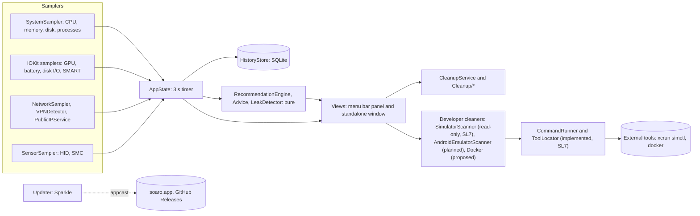

# Soaro: architecture

> Reconstructed on 2026-11-15 from the code and history. To be confirmed.
> Confidence marks: **[H]** directly visible in code or config, **[M]** inferred from several signals, **[L]** a guess.

| | |
| --- | --- |
| Status | draft (reconstructed, extended on 2026-11-15 for the developer cleanup of `SPEC.md` v0.3) |
| Version | 0.2 |
| Date | 2026-11-15 |
| Based on | the code at `e4520dd` (v1.0.1) and `SPEC.md` v0.3 (developer cleanup only). Parts marked "planned" are decisions, not code |

The file-by-file reference, the command-line modes, the macOS permissions and the previous names are in [`docs/architecture.md`](docs/architecture.md). This document is the design view and does not repeat them.

## Context and scope

Soaro runs on one Mac, for one user, in the menu bar. It reads the machine (kernel counters, IOKit, a few system tools), shows it live and as history, and cleans caches and rebuildable folders after the user confirms. **[H]** `SoaroApp.swift`, README.

Outside the app: the website `soaro.app` (it serves the update feed through a redirect), GitHub Releases (the update archives), and two optional third-party lookups (public IP, ping to 1.1.1.1), both off by default. **[H]** README "Privacy".

## Decision drivers

1. **Safety of deletion**: never delete outside the home folder, always confirm. **[H]** README "Safety", `CleanupSafetyTests`.
2. **Cheap when idle**: 20-35 MB RAM and 1-2% of one core. **[H]** README; views removed when the panel is hidden.
3. **Privacy**: nothing leaves the Mac by default. **[H]** README "Privacy".
4. **Honesty about fragile data**: a failed sensor read hides the section. **[H]** `docs/architecture.md`.
5. **Testable without a real Mac**: pure functions for analysis and explicit locale in formatting. **[H]** `docs/architecture.md`.

For the developer cleanup (`SPEC.md`), the ranking agreed on 2026-11-15 is: 1 safety of deletion, 2 honesty about fragile data (external tools can be missing, fail or change their output), 3 testable without the real tool, 4 privacy, 5 cheap when idle. The time box (14 working days for the Must scope) acts as a sixth driver: copy the existing patterns before inventing a framework.

## Overview

One `AppState` object (main actor) owns a 3-second timer. Each tick asks the samplers for a snapshot, appends to in-memory curves, feeds the aggregator that writes to SQLite, and recomputes recommendations. The views only read `AppState`. **[H]** `AppState.swift:185-250`.

## Components

| Component | Responsibility | Depends on |
| --- | --- | --- |
| `SoaroApp` / `AppDelegate` | `MenuBarExtra` scene, accessory activation policy (no Dock icon), CLI modes and demo/snapshot hooks, reopening opens the window | AppState, Updater |
| `AppState` | Timer, sampling cadence, history writes, actions, notifications, cleanup scans | Samplers, HistoryStore, engines, CleanupService |
| Samplers (`SystemSampler`, `Samplers/*`) | Read the machine; parse `ps`, `top`, `nettop`, `osascript` output | Mach, `sysctl`, IOKit, HID, SMC, system tools |
| `HistoryStore` | SQLite, aggregation by time slices, 30-day retention | `sqlite3` |
| `RecommendationEngine`, `Advice`, `LeakDetector` | Pure analysis: measurements in, recommendations and tips out | Models only |
| `CleanupService`, `Cleanup/*` | Scanners (caches, large files, dev artifacts, uninstaller leftovers, login items) and the deletion rules | FileManager, Finder (Apple Events) |
| `CommandRunner` (implemented, SL7; ADR 0009) | Protocol `CommandRunner` (`Cleanup/CommandRunner.swift`) and `RealCommandRunner` (`Cleanup/RealCommandRunner.swift`, the only new code that uses `Process`): absolute path only, no shell (`sh`, `bash`, `zsh`, `dash`, `ksh`, `csh`, `tcsh`, `fish` and `env` are refused, also through `..` or a symlink), arguments as an array, stdin `/dev/null`, a time limit that kills the process with SIGKILL, output read while running and bounded per stream (past the cap: the process is killed, the output cut, `truncated` set). Outcomes: completed, timed out, failed to launch, refused. No default runner: scanners take it as a parameter without a default value, and the real one is built in exactly two places, `Diagnostics.scan` (through `Diagnostics.simulatorScan`) and `CleanupTab` (a source test allows nothing else). The fake is hand-written in the test target. **Known limit:** grandchild processes of a killed tool are not killed. The four existing copies of a `Process` helper stay | Foundation `Process` |
| `SimulatorToolDetector` (implemented, SL8; pure, injectable) | Looks at the disk and **launches nothing** (no `xcrun`, no `xcode-select`, no `DEVELOPER_DIR`, no PATH): the devices folder exists, or **the `simctl` that `/usr/bin/xcrun` will actually run** is an executable regular file. `xcrun` follows the active developer folder, so: if `/var/db/xcode_select_link` is a symbolic link, the only candidate is its destination plus `/usr/bin/simctl` (a relative destination is resolved against `/var/db`; no fallback, so Command Line Tools active with Xcode installed gives "absent"); only when the link is missing, `xcode-select`'s own fallback: `/Applications/Xcode.app/Contents/Developer/usr/bin/simctl`, then each `/Applications/Xcode*.app` by name. Tool present = devices folder or the active `simctl`. Xcode copies under `~/Applications` are not found (accepted) | FileManager (behind a small protocol) |
| `ToolLocator` (implemented for `xcrun` only, SL7; ADR 0009) | Returns the first candidate that is an absolute path to an executable regular file, else nothing; the simulator candidates are exactly `/usr/bin/xcrun`. Gate (SL8): `simulatorXcrunPath` gives `/usr/bin/xcrun` only when the detection found a `simctl`, so the runner is never called without the active `simctl`; `Diagnostics.simulatorScan` (used by `--scan`) applies the same gate. Android (SL10) and Docker (SL13) candidates come with their slices. Target design: finds `xcrun`, the Android SDK (`ANDROID_SDK_ROOT`, `ANDROID_HOME`, then `~/Library/Android/sdk`) and later `docker` from candidate paths, never the PATH | FileManager |
| `SimulatorScanner` (read-only part implemented, SL7; removal planned, SL9) | Runs `/usr/bin/xcrun simctl list devices -j` (time limit **60 s**, output cap **8 MiB**), parses it (`SimulatorDevice`), then measures `CleanupService.allocatedSize` of `~/Library/Developer/CoreSimulator/Devices/<udid>` (the whole device folder; never `dataPath` or `dataPathSize` from the tool; the UDID must match the UUID pattern before it is joined to a path). States: ok, tool not found, command failed, timed out, output not readable (a truncated output is not parsed). No fallback to a folder listing when the tool fails. The listing is a separate synchronous step (`list`, one runner call, devices without sizes) and the folder of a device is built by `deviceFolder(udid:home:)` (valid UDID only); `scan` is rebuilt on both. Removal through `simctl delete` and the refusal of a running device come with SL9 | CommandRunner, ToolLocator, CleanupService |
| `AndroidEmulatorScanner`, Android image scanner (planned) | Reads `~/.android/avd` (`.ini`, `config.ini`), detects a running AVD from the process list (`-avd <name>`), removes the `.ini` and `.avd` pair, links system images to their AVDs | FileManager, process list |
| `DeviceSuggestions` (implemented, SL7, pure) | Pre-selects devices idle for strictly more than the limit (whole days, the limit is a parameter, default 60 days provisional) and older copies of the same model and runtime; devices under 100,000,000 bytes are counted, not listed. Shared later by iOS and Android (SL10) | Models only |
| `SimulatorsModel`, `SimulatorsView`, `SimulatorPresentation` (implemented, SL8) | The tool of the Cleanup tab, read-only. The model (`@MainActor`, owned by `CleanupTab`) takes the runner **without a default**, the detection, `home`, `now`, `measure` and the demo flag; the listing runs in a detached task (utility priority) with a `CancelToken`, never in the 3-second tick, and the real runner is built in a **second place**, `CleanupTab` (the first is `Diagnostics.scan`; a source test allows nothing else). States: not scanned, listing, failed (neutral message; "did not answer" for a time-out), empty, listed. **Progressive sizes:** rows appear when the list arrives (listing order, size "…"), each size is measured one device at a time off the main actor and applied as it arrives, a device under 100,000,000 bytes leaves the list and the selection at once, and the rows are sorted by size when the last size arrives; a cancelled scan applies nothing more. The pre-selection comes from `DeviceSuggestions` (unknown sizes count as big enough until measured); a limit change (30, 60, 90, 180 days, not remembered) replaces the selection with no rescan. `SimulatorPresentation` is the pure text (system label with `xrOS` shown as `visionOS`, reason line, the kept device's name, VoiceOver description). Delete is disabled until SL9. Demo mode returns made-up devices at once (`DemoData.simulators`) | CommandRunner, ToolLocator, SimulatorToolDetector, DeviceSuggestions, CleanupService |
| `SimulatorReport` (implemented, SL7, pure) | The text of the `== iOS Simulators` section of `Soaro --scan`, in plain English (not localised), built from a scan result, the suggestions, a locale and the limit | Format |
| Docker cleaner (proposed, ADR 0010) | Lists usage and prunes the build cache and untagged images through the `docker` command; measures the host space returned | CommandRunner, ToolLocator |
| `Views/*`, `MainWindow` | Tabbed panel and standalone window (AppKit window, created on demand). The cleanup tool models are `StateObject`s of `CleanupTab`, not part of `AppState`; the route `CleanupRoute.simulators` (SL8, implemented) opens the tool "Simulators and emulators" (iOS and Android in one list, `DESIGN.md`; Android comes with SL10), and a second route for Docker only if Test B passes | AppState |
| `Updater` | Sparkle, inactive without `SUFeedURL` and `SUPublicEDKey` | Sparkle |
| `LegacyMigration` | Imports history and preferences from former app names | UserDefaults, files |
| `DemoData`, `Snapshot`, `Diagnostics` | Demo mode, PNG snapshots, read-only CLI output | AppState |
| `scripts/`, `.github/workflows/` | App assembly, signing, DMG, notarization, appcast, CI | Xcode 26, Sparkle tools |

All **[H]**, from `docs/architecture.md` and the sources.

### Simulator scan (SL7, 2026-11-16): facts recorded

- **A1, last-used key.** Read from the real output of `xcrun simctl list devices -j` on the author's Mac: the key is `lastUsedAt`, an ISO 8601 date without fractional seconds (the parser also accepts fractional seconds). It is present on some devices only (16 of 42): the others are "unknown" and are never pre-selected. `lastBootedAt` is read only if `lastUsedAt` is absent. No file date is used.
- **A8, runner values.** `simctl list`: time limit 60 s, output cap 8 MiB. These are the only values in the code (constants of `SimulatorScanner`); the runner has no default limit.
- **Truncated or killed output.** When the output passes the cap the runner kills the process, so the exit code is a signal number (9). `CommandOutput.termination` tells an ordinary exit from a signal; the scanner reports a truncated output as "output not readable" whatever the code, and a process ended by a signal as "command failed" without an exit code.
- **Prerequisite for SL8 (tool detection), done in SL8 (`SimulatorToolDetector`, see the components table).** `/usr/bin/xcrun` is a stub shipped with every macOS, so `ToolLocator` finding it does not mean `simctl` can run. Without the Command Line Tools or Xcode it may open the system "install developer tools" dialog (inferred, not tried); with the Command Line Tools only, `simctl` is missing and the command exits non-zero. SL8's rule "the row appears only if the simulator tool is found" uses a prompt-free check, one that launches nothing that can open a window.
- **Older copy of a small device.** Small devices (under 100 MB) take part in the grouping but are not listed, so a listed device can be an "older copy" of an unlisted one. Done in SL8: `DeviceSuggestions.Row.keptDevice` names the kept device in the reason.
- **A3, running.** A device is running when its state is not `Shutdown` (`Booted`, `Booting`, `Shutting Down`, or a state that is unknown or missing). A running device is never pre-selected and counts as used now.
- **A4, grouping.** Same model (`deviceTypeIdentifier`, the name if it is missing) and same runtime identifier; the most recently used device of a group is kept, the other dated ones are "older copies". All devices take part in the grouping, including the small ones that are not listed.
- **A6, runtimes.** All runtimes are listed (iOS, watchOS, tvOS, visionOS); an unavailable device is listed and flagged. SL8 labels them: one group "iOS Simulators", each row shows its system, `xrOS` is shown as `visionOS`.
- **Sizes.** The scan of 42 devices (about 45 GB) took 16.5 s and 23.2 s on the author's Mac (debug build); SL8 shows sizes progressively (about 17 s for the whole scan on the same Mac, debug build, with the new code).
- **Limit.** The 60-day default is provisional until the author's check on 5 devices.

## Data and storage

- **History**: `~/Library/Application Support/Soaro`, SQLite (WAL), one aggregated row per ~30 s, kept 30 days. **[H]** `HistoryStore.swift`.
- **Preferences**: `UserDefaults` (`SettingsKey`). **[H]**
- **Nothing else is stored.** Public IP lookups are not stored. **[H]** README.

## Key flows

1. **Measure and show** (every 3 s): timer, then `tick()`: snapshot, curves, aggregation, recommendations, views update. Battery every 9 s and sensors every 9 s when the panel is closed (every 3 s when visible). **[H]** `AppState.tick`.
2. **Clean up**: scan (every 30 min and on demand), then the user chooses, then a confirmation, then `isSafeToDelete` per path, then delete (caches, rebuildable folders) or move to the Trash (large files, uninstalled apps), then a rescan. The Trash is emptied through Finder with `osascript`. **[H]** `CleanupService.swift`, `AppUninstaller.swift`, `DevArtifactScanner.swift`.
2b. **Clean up a target owned by a tool** (planned, ADR 0009): the user opens the tool view, a scan runs in a detached task (never in the 3-second tick), the pure suggestion function pre-selects, then a confirmation naming the target, its size and what is lost, then a check that the target is not running, then the action (`simctl delete`, or the AVD pair), then a rescan and the space really freed. A failed step stops that target; there is no fallback to deleting files. Demo mode returns fake data and runs nothing.
3. **Update**: Sparkle reads `soaro.app/appcast.xml`, which redirects to the latest GitHub release; it downloads the DMG and checks its EdDSA signature against the public key in `Info.plist`. **[H]** `docs/updates.md`, `site/_redirects`.
4. **Release**: tag `vX.Y.Z`, then `release.yml` on `macos-26`: tests, import certificate, `scripts/release.sh --notarize`, then the GitHub release with the DMG and the appcast. **[H]** `.github/workflows/release.yml`.

## Cross-cutting concerns

- **Security and privacy**: not sandboxed; deletion confined to the home folder; two optional network features off by default; Sparkle verifies update signatures; secrets only in GitHub Actions secrets. **[H]**
- **Errors and recovery**: sensor failures hide the section; a failed delete counts as a failure and continues; a missing history database leaves history disabled (`history?`). **[M]**
- **Observability**: `SOARO_DEBUG` traces, `--diagnostics`. No telemetry. **[H]**
- **Testing**: Swift Testing, 135 tests, mostly pure functions and parsers (see `TESTING.md`). **[H]** For the developer cleanup: a fake `CommandRunner` and real outputs from the author's Mac (`simctl list devices -j`, AVD `config.ini`), anonymized and written inline in the tests, so `Package.swift` does not change. Every new model has a demo-mode branch. (planned) Testability requirements, from `TESTING.md` (2026-11-15): the root or home folder, `now`, the environment, the process list, the free-space provider and the confirmation are parameters with defaults; the scanners and removers take the command runner as a parameter with **no default**, so a test cannot reach a real tool; the cleanup models receive an injectable confirmation instead of calling `AppState.confirm` directly (done by SL1, 2026-11-16, for the four models; `AppState.cleanup` still calls it directly); `CleanupService.directory(for:)` takes the home folder as a parameter.
- **Build and release**: SwiftPM binary assembled by `scripts/build-app.sh` (Info.plist written by the script, Sparkle embedded, translations compiled with `xcstringstool`). **[H]**
- **Cost to run**: GitHub Actions minutes on a public repository (free), Cloudflare Pages (free tier), one Apple Developer account. **[M]**

## Decisions

| ADR | Decision | Status |
| --- | --- | --- |
| [0001](docs/adr/0001-native-swift-menu-bar-app.md) | Native Swift menu bar app, macOS 14+, Apple silicon only | accepted (reconstructed) |
| [0002](docs/adr/0002-distribution-outside-the-app-store.md) | Distribute outside the Mac App Store, not sandboxed | accepted (reconstructed) |
| [0003](docs/adr/0003-sparkle-updates-and-appcast-as-release-asset.md) | Sparkle updates; the appcast is a release asset reached through a redirect | accepted (reconstructed) |
| [0004](docs/adr/0004-history-in-sqlite.md) | History in SQLite through the C API | accepted (reconstructed) |
| [0005](docs/adr/0005-defensive-sensor-readings.md) | Read hardware sensors through private interfaces, hide what fails | accepted (reconstructed) |
| [0006](docs/adr/0006-cleanup-safety-model.md) | Confirmed, home-folder-only deletion; Trash when recoverable | accepted (reconstructed) |
| [0007](docs/adr/0007-privacy-by-default.md) | Nothing leaves the Mac by default | accepted (reconstructed) |
| [0008](docs/adr/0008-release-built-on-github-actions-xcode-26.md) | Release built by GitHub Actions on Xcode 26 | accepted (reconstructed) |
| [0009](docs/adr/0009-cleanup-actions-by-supported-route-under-one-contract.md) | Cleanup actions that are not plain deletion: the supported route per target, under one contract (completes 0006) | accepted |
| [0010](docs/adr/0010-docker-targeted-prune-measured-by-host-space.md) | Docker: a targeted prune through the docker command, measured by the space returned to the Mac | proposed (pending Test B) |

Smaller choices (notes, no ADR), developer cleanup, decided 2026-11-15:

- **NuGet** is a new `CleanupKind` (`nugetCache`, `~/.nuget/packages`), like DerivedData or npm: shown only if it exists, excluded from the quick clean (R13). `NUGET_PACKAGES` is not visible to an app started from the Finder, so a moved folder is not found. Other NuGet folders (HTTP cache) are to check when implementing.
- **SwiftPM** needs no new cleaner: the "App caches" kind already covers `~/Library/Caches/org.swift.swiftpm`. Never touch `~/Library/org.swift.swiftpm` (configuration).
- **Simulators and AVD** follow the pattern of "Large files": a scanner (pure parsing plus a scan function), an `ObservableObject` model owned by `CleanupTab`, a view, a new `CleanupRoute`. A detached task with cancellation, as the others. Sizes come from `CleanupService.allocatedSize` on the device folder, not from `dataPathSize` (about 7 GB apart on the author's Mac, R7).
- **Scans** run when the tool view opens, never in the 3-second tick. Only the cheap size of the NuGet folder joins the periodic cleanup scan.
- **Tests**: see "Testing" above.
- **Not decided here**: the layout on screen (for the `ux` skill) and the exact `docker` commands (after Test B).

Earlier smaller choices:

- Swift 5 language mode inside a Swift 6 tools package, so strict concurrency is off. Reason unknown, to confirm. **[H]** `Package.swift`.
- The app Info.plist is written by `build-app.sh`, not by Xcode. **[H]**
- The main window is AppKit (created on demand, destroyed on close) rather than a SwiftUI `Window` scene; reason inferred: cost when idle. **[L]**
- GPL-3.0 licence. **[H]** `LICENSE`.

## Traceability

`SPEC.md` covers only the developer cleanup; the features that already exist have no requirement IDs (see the README tables). Mapping for R1 to R19:

| Requirement | Priority | Component | Decision |
| --- | --- | --- | --- |
| R1 NuGet cache | Must | `CleanupService` (new `nugetCache` kind), Cleanup view | note |
| R2 SwiftPM cache | Covered | existing `caches` kind | note |
| R3 iOS simulator list and suggestions | Must | `SimulatorScanner`, `DeviceSuggestions`, Cleanup view | 0009 |
| R4 supported removal | Must | `SimulatorScanner`, `CommandRunner` | 0009 |
| R5 never a running device | Must | `SimulatorScanner` (state `Booted`) | 0009 |
| R6 absent or failing tool never breaks the view | Must | `ToolLocator`, `CommandRunner`, scanners | 0009, 0005 |
| R7 real size and freed space | Must | `CleanupService.allocatedSize`, rescan after action | 0009 |
| R8 confirmation | Must | tool models, `AppState.confirm` | 0006, 0009 |
| R9 no network | Must | local executables only; no network code | 0007, 0009, 0010 |
| R10 Docker prune | Should | Docker cleaner | 0010 (proposed) |
| R11 honest space returned | Should | Docker cleaner (free space before and after) | 0010 (proposed) |
| R12 translations | Should | `Localizable.xcstrings` (existing process) | none |
| R13 no quick clean | Should | `CleanupKind.includedInQuickClean` | note |
| R14 recommendations | Could | `RecommendationEngine` | none |
| R15 OrbStack | Could | `ToolLocator` candidate path | 0010 |
| R16 Android device list and suggestions | Must | `AndroidEmulatorScanner`, `DeviceSuggestions` | 0009 |
| R17 AVD removal with its registration | Must | `AndroidEmulatorScanner` (pair removal, running check) | 0009 |
| R18 find the Android SDK | Must | `ToolLocator` | 0009 |
| R19 Android system images | Should | Android image scanner | 0009 |

Components with no requirement of their own: `CommandRunner` (serves R4, R6, R17 and Docker) and `DeviceSuggestions` (serves R3 and R16). Every Must requirement maps to at least one component.

## Risks and spikes

| # | Risk or unknown | Spike or mitigation | Status |
| --- | --- | --- | --- |
| 1 | HID and SMC readings break on a new macOS | Failed read hides the section (ADR 0005); test the app on each macOS beta | open |
| 2 | Docker, OrbStack and simulator cleanup is more dangerous than file caches (shared volumes, running containers) | Contract of ADR 0009 for simulators and Android; Docker waits for Test B (ADR 0010) | simulators and Android: decided; Docker: open until Test B |
| 5 | An Android AVD removed as its `.ini` and `.avd` pair may leave something that `avdmanager delete` would have removed | Create a disposable AVD, remove it both ways, compare what is left (first Android task) | open |
| 6 | A running emulator is detected from the process list (`-avd <name>`), untested with a real emulator | Test with a real running emulator and a fixture | open |
| 7 | Docker Desktop may not give disk space back to the Mac after a prune | Test B (at least half of the announced space comes back, else drop Docker) | open |
| 8 | An Xcode, Android or Docker update changes the output of the tools, and a cleaner silently disappears | Defensive reading (R6, ADR 0005); one test per cleaner on a recorded real output | open |
| 3 | Sparkle's window may stay behind other windows for an app without Dock icon | Test during the 1.0.0 to 1.0.1 update | open (`docs/updates.md`) |
| 4 | Strict concurrency never enabled | Try Swift 6 mode in a branch and count the errors | open |

## Deferred and open

- Not decided yet: who reviews the translations; the exact Docker commands (after Test B); the screen layout of the new tools; which file date is the best "last used" signal for an Android AVD (spec open question); the default 60-day threshold, to confirm with the author on 5 simulators.
- Deliberately out of scope for the developer cleanup: simulator runtimes (31.5 GB on the author's Mac, outside the home folder). Reopen ADR 0006 and ADR 0009 together if the author decides to include them.
- Deliberately out of scope: Intel Macs, the Mac App Store (README "Limits").
- Rationale unknown, to confirm: Swift 5 language mode; the choice of an AppKit window.

## Change log

| Date | Change | ADR |
| --- | --- | --- |
| 2026-11-15 | Reconstructed from the code at `e4520dd` | 0001-0008 |
| 2026-11-15 | Developer cleanup designed from `SPEC.md` v0.3: contract for tool-owned cleanup actions, proposed Docker decision, notes for NuGet, SwiftPM, simulators, Android and tests | 0009, 0010 (proposed) |
| 2026-11-16 | SL7: `CommandRunner`, `ToolLocator` (xcrun), `SimulatorScanner` (read-only), `DeviceSuggestions` implemented; facts of the simulator scan recorded (last-used key, limits, running rule, grouping key). No decision changed | 0009 |
| 2026-11-16 | SL8: `SimulatorToolDetector` (disk-only detection and the runner gate), `SimulatorsModel` / `SimulatorsView` / `SimulatorPresentation`, the kept device of an older copy, progressive sizes; the real runner is now built in two places (`Diagnostics.scan`, `CleanupTab`). No decision changed (completes rule 4 of ADR 0009) | 0009 |
