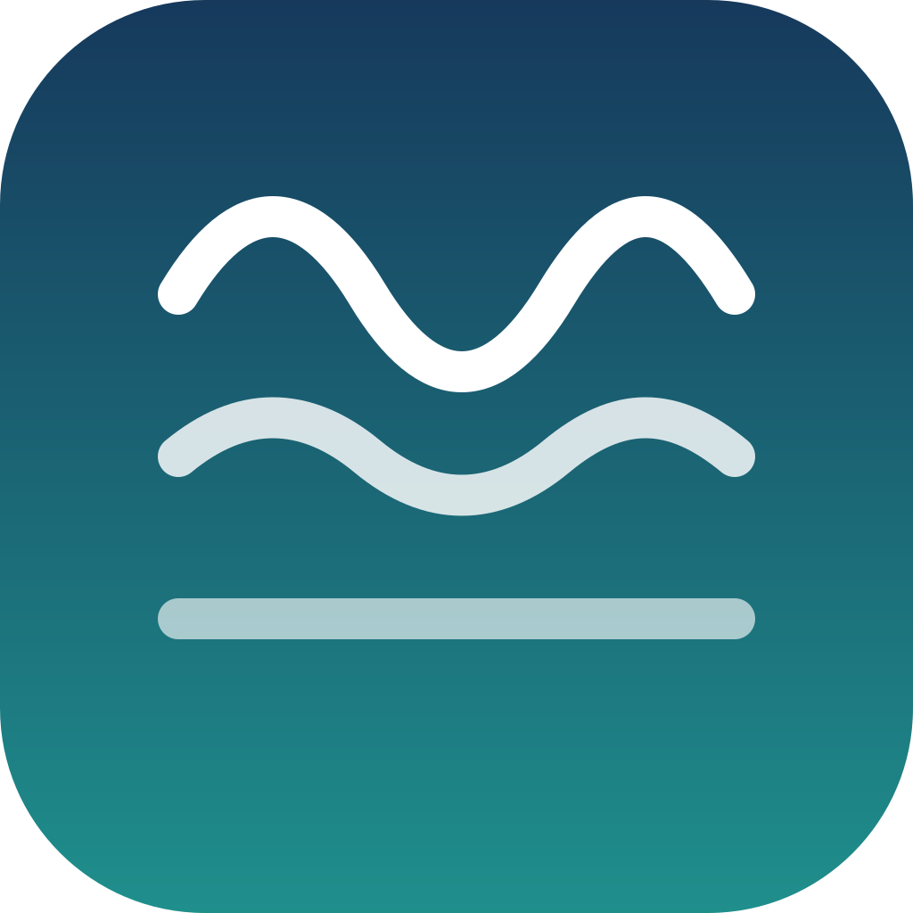

# Soaro

*Soaro*, de l'anglais *to soar* : s'élever, planer. Un Mac allégé de tout ce qui l'alourdit.

Soaro est une petite application macOS native qui vit dans la barre de menus. Elle surveille **CPU, GPU, mémoire, disque, réseau et batterie**, garde un historique, et propose des actions concrètes pour garder le Mac rapide et propre.

Au repos, elle utilise environ 20-35 Mo de RAM et 1-2 % d'un cœur. Elle n'envoie aucune donnée, sauf si vous activez deux options réseau (voir [Vie privée](#vie-privée)).

[English](README.md) · [Site](https://soaro.app) · [Télécharger](https://github.com/sebmafate/soaro/releases/latest)

## À quoi ça sert

| Onglet | Contenu |
| --- | --- |
| **Aperçu** | Six jauges avec courbes, recommandations, apps les plus gourmandes |
| **Performances** | Charge **par cœur** (cœurs E et P), détail mémoire, GPU, débit et état SMART du disque, **températures, ventilateurs, consommation** |
| **Batterie** | Niveau, temps restant, **santé**, **cycles**, puissance en watts, **impact énergétique par app** |
| **Réseau** | Débits, volume du jour, **détection du VPN**, qualité du Wi-Fi, **trafic par app**. IP publique et pays en option |
| **Historique** | Graphiques sur 1 h, 24 h, 7 j ou 30 j, stockés sur votre Mac |
| **Nettoyage** | Caches, **gros fichiers**, **projets de dev inactifs** (`node_modules`, `.build`, `Pods`...), **désinstalleur** qui retire aussi les restes, **éléments de démarrage** |
| **Ce Mac** | Modèle, puce, cœurs, mémoire, écrans, numéro de série |

Deux façons de l'utiliser :

- **Le panneau de la barre de menus** : un coup d'œil, il se referme quand on clique ailleurs.
- **La fenêtre indépendante** : barre latérale, effet de verre translucide, bouton épingle pour la garder au premier plan.

Dans la barre de menus, chaque valeur choisie passe à l'**orange**, au **rouge**, puis à l'**écarlate** quand elle se dégrade. Les seuils sont réglables. Survolez l'icône pour voir pourquoi une valeur est colorée.

### Recommandations et conseils

Soaro prévient en cas de disque presque plein, de mémoire sous pression, de **fuite mémoire probable**, de CPU saturé, de Mac qui chauffe, de batterie faible ou usée. Elle ne notifie que les problèmes critiques.

Elle lit aussi certains réglages de macOS et donne des **conseils** (mode économie d'énergie, app qui bloque la veille, trop de programmes au démarrage, optimisation du stockage, mise à jour en attente, sauvegarde Time Machine). Elle **ne modifie jamais un réglage** : le bouton ouvre le bon panneau de Réglages Système, et vous décidez.

## Installation

1. Téléchargez le dernier `Soaro-x.y.z.dmg` sur la [page des versions](https://github.com/sebmafate/soaro/releases/latest).
2. Ouvrez-le et glissez **Soaro** dans **Applications**.
3. Lancez Soaro. Elle apparaît dans la barre de menus.

L'app est signée avec un Developer ID et notarisée par Apple. Elle se met à jour toute seule avec [Sparkle](docs/updates.md), désactivable dans les réglages.

**Prérequis :** un Mac Apple silicon, macOS 14 Sonoma ou plus récent.

## Vie privée

- Soaro travaille **en local**. L'historique reste dans `~/Library/Application Support/Soaro`, pendant 30 jours.
- Deux options sont **désactivées par défaut** : le test de latence (un petit ping vers `1.1.1.1`) et la recherche d'IP publique et de pays. Cette recherche interroge un service tiers (ipwho.is, ou ipapi.co en secours), qui voit alors votre IP publique. La détection du VPN est entièrement locale.
- La vérification des mises à jour télécharge un fichier public sur soaro.app, une fois par jour, sans aucune donnée personnelle.
- Pas de compte, pas de statistiques, pas de pistage.

## Sécurité

Soaro supprime des fichiers, donc elle est prudente :

- Tout est **confirmé avant** suppression.
- Elle ne touche qu'à votre **dossier personnel**, jamais au dossier personnel lui-même. Cette règle est testée.
- Les gros fichiers et les apps désinstallées vont à la **corbeille** (récupérables). Les caches et dossiers régénérables sont supprimés directement, après confirmation.
- Un dossier de projet n'est proposé que si son fichier de projet est à côté (`package.json`, `Package.swift`, `Cargo.toml`...). Un `build/` ou `dist/` n'est jamais proposé.
- Le désinstalleur cherche les restes par identifiant exact. Il refuse les apps Apple et les apps ouvertes.

## Limites

Je préfère être clair sur ce que Soaro ne sait pas faire :

- **Apple silicon uniquement.** Les Mac Intel ne sont pas pris en charge.
- Les températures, ventilateurs et la consommation passent par des **interfaces privées d'Apple** (HID et SMC). Une nouvelle version de macOS peut les casser. Si une lecture échoue, la section disparaît.
- L'app n'est **pas en bac à sable** : elle ne peut pas être sur le Mac App Store. Elle a besoin d'accéder à vos fichiers pour les trouver et les nettoyer.
- Certaines infos demandent une autorisation : la taille de la corbeille veut l'accès complet au disque, le nom du Wi-Fi veut la localisation.
- « Ouvrir à la connexion » ne marche que si l'app est dans `/Applications`.
- Les traductions (allemand, espagnol, italien, portugais du Brésil, japonais, chinois simplifié, coréen) ont été faites avec l'aide d'une IA et doivent être relues par des locuteurs natifs. [Votre aide est bienvenue](CONTRIBUTING.md#translations).

## Langues

Anglais, français, allemand, espagnol, italien, portugais du Brésil, japonais, chinois simplifié et coréen. Soaro suit la langue de votre Mac.

## Compiler depuis les sources

Il faut macOS 14 ou plus et Xcode avec Swift 6.

```bash
swift run                         # lancer en développement
swift test                        # lancer les tests
scripts/build-app.sh              # produire build/Soaro.app
scripts/build-app.sh --install    # idem + copie dans /Applications
```

L'organisation du code est décrite dans [docs/architecture.md](docs/architecture.md). Pour contribuer, lisez [CONTRIBUTING.md](CONTRIBUTING.md).

## Soutenir le projet

Soaro est gratuite et open source. Si elle vous fait gagner du temps, vous pouvez soutenir son développement. C'est facultatif, et ça m'aide à continuer.

[Offrez-moi un café](https://buymeacoffee.com/sebmafate)

## Licence

[GPL-3.0](LICENSE). Copyright © 2026 Sébastien Ferrand.
