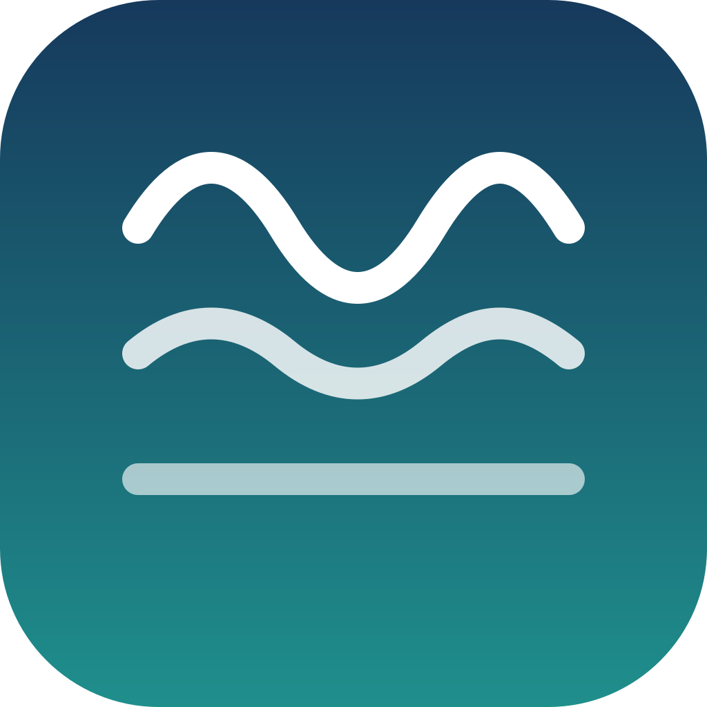

# Soaro

*Soaro*, from *to soar*: a Mac that is free of what weighs it down.

Soaro is a small, native macOS app that lives in the menu bar. It watches **CPU, GPU, memory, disk, network and battery**, keeps a history, and suggests concrete actions to keep your Mac fast and clean.

It uses about 20-35 MB of RAM and 1-2% of one CPU core when idle. It sends no data anywhere, unless you turn on two optional network features (see [Privacy](#privacy)).

[Français](README.fr.md) · [Website](https://soaro.app) · [Download](https://github.com/sebmafate/soaro/releases/latest)

## What it does

| Tab | What you get |
| --- | --- |
| **Overview** | Six gauges with live curves, recommendations, and the apps that use the most resources |
| **Performance** | Load **per core** (efficiency and performance cores), memory details, GPU, disk speed and SMART status, **temperatures, fans and power draw** |
| **Battery** | Level, time left, **health**, **cycle count**, power in watts, and **energy impact per app** |
| **Network** | Speed, daily volume, **VPN detection**, Wi-Fi quality, and **traffic per app**. Public IP and country are optional |
| **History** | Charts over 1 hour, 24 hours, 7 days or 30 days, stored on your Mac |
| **Cleanup** | Caches, **large files**, **inactive dev projects** (`node_modules`, `.build`, `Pods`...), the **NuGet package cache**, **iOS simulators** and **Android emulators** (inactive ones pre-selected, Android system images shown for information), **Docker** (build cache and untagged images, with the space really returned to your Mac), an **app uninstaller** that also removes leftovers, and **login items** |
| **This Mac** | Model, chip, cores, memory, displays and serial number |

You can use it in two ways:

- **The menu bar panel** gives a quick look and closes when you click elsewhere.
- **The standalone window** has a sidebar and a translucent glass look. A pin button keeps it on top.

In the menu bar, each value you choose turns **orange**, **red**, then **scarlet** as it gets worse. You can change the thresholds. Hover over the icon to see why something is colored.

### Recommendations and tips

Soaro warns you about a full disk, memory under pressure, a **probable memory leak**, a saturated CPU, a hot Mac, and a weak or worn battery. It only sends a notification for critical problems.

It also reads some macOS settings and gives you **tips** (Low Power Mode, apps blocking sleep, too many login items, storage optimization, pending updates, Time Machine backup). It **never changes a setting**. The button opens the right pane in System Settings, and you decide.

## Install

1. Download the latest `Soaro-x.y.z.dmg` from the [releases page](https://github.com/sebmafate/soaro/releases/latest).
2. Open it and drag **Soaro** to **Applications**.
3. Open Soaro. It appears in the menu bar.

The app is signed with a Developer ID and notarized by Apple. It updates itself with [Sparkle](docs/updates.md). You can turn this off in the settings.

**Requirements:** a Mac with Apple silicon, macOS 14 Sonoma or later.

## Privacy

- Soaro runs **locally**. Your history stays in `~/Library/Application Support/Soaro` and is kept for 30 days.
- Two options are **off by default**: the latency test (a small ping to `1.1.1.1`) and the public IP and country lookup. The lookup asks a third-party service (ipwho.is, or ipapi.co as a backup), which then sees your public IP. VPN detection is fully local.
- The update check downloads a public file from soaro.app once a day. It sends no personal data.
- There is no account, no analytics and no tracking in the app. The website soaro.app counts visits with [Umami](https://umami.is), without cookies.

## Safety

Soaro deletes things, so it is careful:

- Everything is **confirmed before** it is deleted.
- It only touches your **home folder**, never the home folder itself. This rule has tests.
- Large files and uninstalled apps go to the **Trash**, so you can get them back. Caches and rebuildable folders are deleted directly, after you confirm.
- A project folder is only suggested if its project file is next to it (`package.json`, `Package.swift`, `Cargo.toml`...). A `build/` or `dist/` folder is never suggested.
- The uninstaller matches leftovers by exact bundle identifier. It refuses Apple apps and apps that are still running.

## Limits

I prefer to be clear about what Soaro cannot do:

- **Apple silicon only.** Intel Macs are not supported.
- Temperature, fan and power readings use **private Apple interfaces** (HID and SMC). They can break with a new macOS version. If a reading fails, that section disappears.
- It is **not sandboxed**, so it cannot be on the Mac App Store. It needs access to your files to find and clean them.
- Some information needs permissions: the Trash size needs Full Disk Access, and the Wi-Fi name needs location access.
- "Open at login" only works if the app is in `/Applications`.
- Translations (German, Spanish, Italian, Brazilian Portuguese, Japanese, Simplified Chinese, Korean) were made with AI help and need review by native speakers. [Help is welcome](CONTRIBUTING.md#translations).

## Languages

🇬🇧 English · 🇫🇷 Français · 🇩🇪 Deutsch · 🇪🇸 Español · 🇮🇹 Italiano · 🇧🇷 Português (Brasil) · 🇯🇵 日本語 · 🇨🇳 简体中文 · 🇰🇷 한국어

Soaro follows the language of your Mac.

## Build from source

You need macOS 14 or later and Xcode with Swift 6.

```bash
swift run                         # run in development
swift test                        # run the tests
scripts/build-app.sh              # build build/Soaro.app
scripts/build-app.sh --install    # build and copy to /Applications
```

The code and how it is organized are described in [docs/architecture.md](docs/architecture.md). To contribute, read [CONTRIBUTING.md](CONTRIBUTING.md).

## Support the project

Soaro is free and open source. If it saves you time, you can support its development. It is optional, and it helps me keep working on it.

[Buy me a coffee](https://buymeacoffee.com/sebmafate)

## License

[GPL-3.0](LICENSE). Copyright © 2026 [Sébastien Ferrand](https://sferrand.fr).
